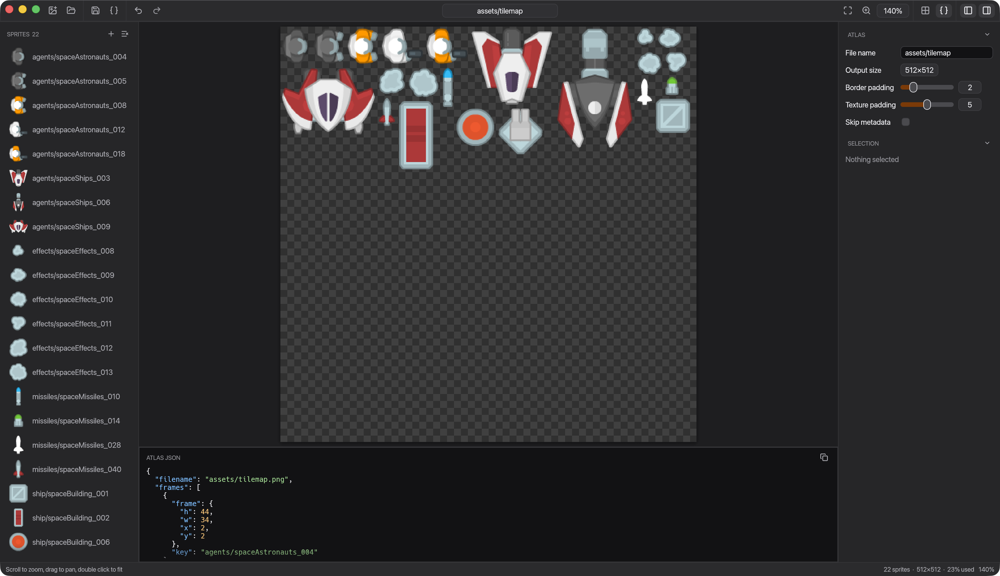

# rPack egui

A both desktop and web frontend for generating sprite atlases. Just drag and drop images or a folder into the program and save the atlas.

To open it in browser click one of the icons below:

## Desktop downloads

The [itch.io page](https://mevlyshkin.itch.io/rpack) has a Windows installer (`.msi`), a macOS installer for Apple Silicon (`.pkg`) and a Linux AppImage. The installers are not signed, so the system warns about them:

- **Windows:** on the SmartScreen prompt choose *More info*, then *Run anyway*.
- **macOS:** after macOS blocks the installer, open *System Settings > Privacy & Security* and choose *Open Anyway*.
- **Linux:** make the AppImage executable with `chmod +x` if your download tool didn't keep the permission.

Available at [crates/rpack_egui](https://github.com/Leinnan/rpack/tree/main/crates/rpack_egui).
